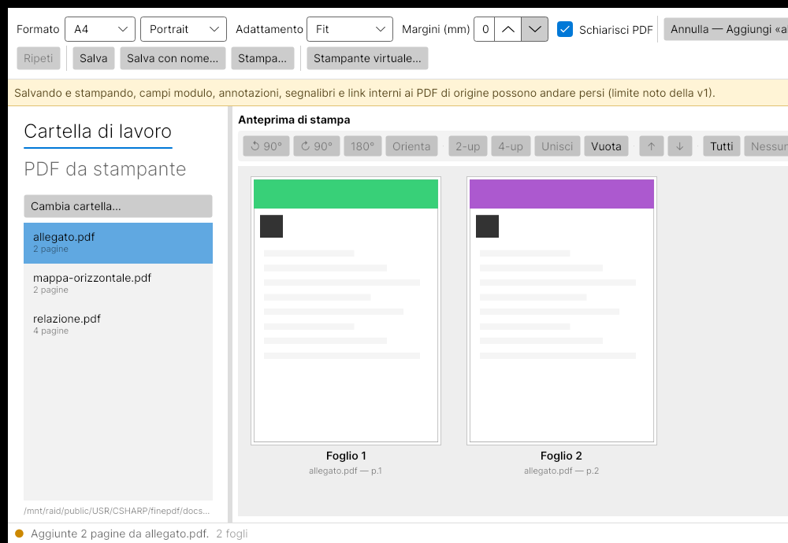
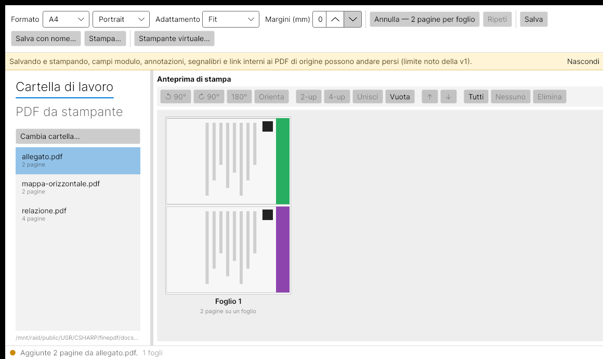

# FinePdf

[🇮🇹 Italiano](README.md) · 🇬🇧 English

**Cross-platform desktop PDF editor (Windows + Linux)** in C# / .NET 8: merge, reorder,
delete, "N pages on one sheet" (N-up) imposition, rotation and printing.

## Features

- **Two-tab sources panel**: *Cartella di lavoro* (browsable; accepts PDFs **and images**
  `png/jpg/bmp/gif/webp`, converted to a one-page PDF each) and *PDF da stampante* (the virtual
  printer's folder, read-only). Double-click a file in either tab to append its pages. Both
  folders are remembered between runs.
- **"FinePdf" virtual printer**: on **Linux** it registers a real system printer (one
  authorisation prompt) → [`docs/virtual-printer.md`](docs/virtual-printer.md); on **Windows**
  you use a free third-party PDF printer and FinePdf just watches its folder →
  [`docs/virtual-printer-windows.md`](docs/virtual-printer-windows.md). Either way the printed
  PDFs show up in the *PDF da stampante* tab.
- **Merge**: double-click a PDF in the sources list → appends all of its pages.
- **Reorder**: drag & drop in the preview, *Move up/down* buttons, `Alt+↑/↓`.
- **Delete**: single or multiple selection, context menu or `Del`.
- **N-up**: select several sheets → *Two / Four pages per sheet*; fill order by row or by
  column; each page is auto-rotated 90° when that fills its cell better. Or *Merge onto one
  sheet*.
- **Rotate**: 90° CW / CCW / 180° (`Ctrl+←/→`).
- **Blank page**: from the context menu, inherits the document's size and orientation.
- **Fit** (`FitMode`): document default + per-sheet override (fit / actual size / fill).
- Uniform page **margins** (mm) applied to every sheet; dashed guide in the preview.
- **Print**: the right pane *is* the print preview; an internal dialog covers printer, copies,
  range (`1-3, 5`), one/two-sided and free-form **advanced options** `key=value` (sent to CUPS
  as `-o key=value`: `media`, `Resolution`, `ColorModel`, …).
  Linux via CUPS (`lp`/`lpstat`), Windows via GDI.
- Full **undo/redo**; *unsaved changes* prompt on close.

## Screenshots

Two-pane print preview — every sheet is drawn at the document's print size:



"Two pages per sheet" with auto-rotation: portrait pages are turned 90° to fill the cells:



Regenerate with `./build/screenshots.sh` (needs Xvfb, xdotool, ImageMagick).

## Quick start

```bash
dotnet build FinePdf.sln
dotnet test
dotnet run --project src/FinePdf.App
```

Requires **.NET SDK 8.0.x**. On Linux/macOS the projects are single-target `net8.0`; on Windows
`FinePdf.App` switches to `net8.0-windows` for GDI printing (`WindowsPrintService`).

The **virtual printer** (Linux) needs at runtime: `cups`, `cups-client`, `ghostscript`,
`python3`, `polkit`/`policykit-1` (optionally `poppler-utils`). See
[`docs/virtual-printer.md`](docs/virtual-printer.md).

## Layout

| Project | Role |
|---|---|
| `src/FinePdf.Core` | PDF logic with no UI dependencies (models, services, undoable operations) |
| `src/FinePdf.App` | Avalonia application (MVVM) |
| `tests/FinePdf.Core.Tests` | xUnit unit tests (sample PDFs generated at runtime) |

Architecture, pinned stack and conventions: [`CLAUDE.md`](CLAUDE.md) (Italian).

## Publishing

```bash
./build/publish.sh linux-x64      # -> artifacts/linux-x64
./build/publish.ps1 -Rid win-x64  # on Windows -> artifacts/win-x64 (GDI printing)
```

Both run `dotnet test` first, then a self-contained single-file `dotnet publish`.
Prebuilt binaries are attached to the GitHub [Releases](../../releases).
